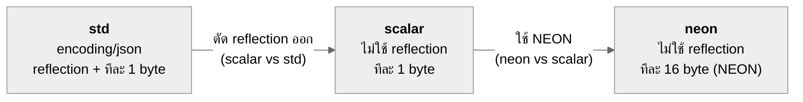
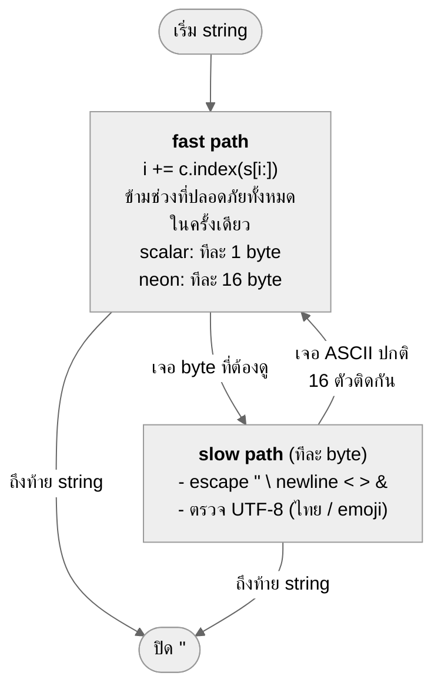
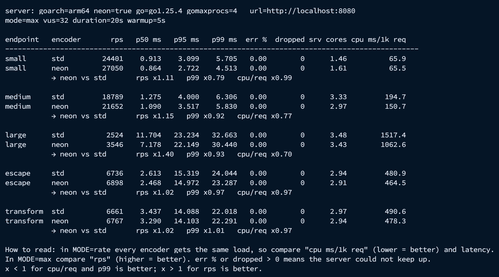
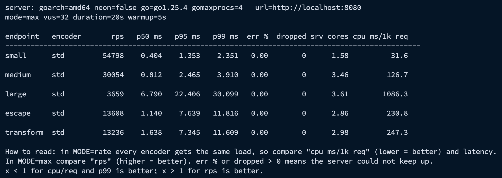

# go-neon-simple

เทียบความเร็ว JSON encoding ของ Go ระหว่าง **x86 standard**, **ARM standard** และ **ARM + NEON (SIMD)**
แบบง่ายที่สุด: server ตัวเดียว + k6 script ตัวเดียว รันจบแล้ว **k6 พิมพ์ตารางเทียบให้เลย**

ไม่ใช้ cgo, ไม่มี dependency นอก standard library (รันเป็น binary ตรง ๆ หรือ [รันเป็น Docker container](#รันด้วย-docker-container) ก็ได้)

---

## หลักการทำงาน: JSON encoding แบบใช้ NEON และไม่ใช้ NEON

### 1. งานที่เราเร่งความเร็วคืออะไร

เวลาแปลงข้อมูลเป็น JSON งานที่กินเวลามากที่สุดคือการเขียน **string** เพราะต้องดูทีละตัวอักษรว่าตัวไหน
"ต้อง escape" ก่อนใส่ลงใน JSON เช่น

| ตัวอักษร | ใน JSON ต้องเขียนเป็น |
|---|---|
| `"` | `\"` |
| `\` | `\\` |
| ขึ้นบรรทัดใหม่ (0x0A) | `\n` |
| control char อื่น ๆ (0x00–0x1F) | `\u00XX` |
| `<` `>` `&` (escape HTML แบบ `encoding/json`) | `\u003c` `\u003e` `\u0026` |
| byte ≥ 0x80 (ภาษาไทย, emoji) | ต้องตรวจว่าเป็น UTF-8 ที่ถูกต้อง |

ในข้อความจริงตัวอักษรส่วนใหญ่ **ไม่ต้อง escape** (a–z, 0–9, ช่องว่าง ฯลฯ)
ดังนั้นคำถามหลักคือ **"ตัวแรกที่ต้อง escape อยู่ตำแหน่งไหน"** ยิ่งหาได้เร็ว ยิ่ง copy ข้อความช่วงที่ปลอดภัยได้เร็ว

```
index :   0   1   2   3   4   5   6   7   8   9  10  11  12  13  14  15
char  :   H   i   _   "   B   o   b   "   _   &   _   y   o   u   !   !
                      ^               ^       ^
                      escape          escape  escape

output:  "Hi \"Bob\" \u0026 you!!"
```

`_` = ช่องว่าง, `^` = ตัวที่ต้อง escape (index 3, 7, 9)

### 2. Encoder 3 แบบในโปรเจกต์นี้

| encoder | URL | วิธีทำงาน | ใช้ได้บน |
|---|---|---|---|
| `std` | `/std/...` | `encoding/json` ของ Go ใช้ reflection อ่าน struct และตรวจ string ทีละ byte | ทุกเครื่อง |
| `scalar` | `/scalar/...` | encoder ที่เขียนเอง **ไม่ใช้ reflection** ตรวจ string **ทีละ 1 byte** | ทุกเครื่อง |
| `neon` | `/neon/...` | encoder ตัวเดียวกับ `scalar` แต่ตรวจ string **ทีละ 16 byte** ด้วย NEON | ARM64 เท่านั้น |

ทั้ง 3 แบบให้ผลลัพธ์ **ตรงกันทุก byte** (ตรวจใน `main_test.go`) ต่างกันแค่ความเร็ว

ทำไมต้องมี `scalar`: `neon` เร็วกว่า `std` ด้วยเหตุผล 2 ข้อรวมกัน คือ (1) ไม่ใช้ reflection และ (2) ใช้ SIMD
การเทียบกับ `scalar` ช่วยแยกผลทั้งสองออกจากกัน



- `scalar vs std` = ผลของการไม่ใช้ reflection
- `neon vs scalar` = ผลของ NEON อย่างเดียว
- `neon vs std` = ผลรวมทั้งสองอย่าง

### 3. โครงสร้างร่วมของ encoder ที่เขียนเอง

ทั้ง `scalar` และ `neon` ใช้ฟังก์ชัน `str()` ตัวเดียวกัน (`main.go`) ต่างกันแค่ฟังก์ชัน `index`
ที่ใช้หาตำแหน่งแรกที่ต้อง escape

```go
type codec struct {
    name  string
    index func(string) int // indexScalar หรือ indexNEON
}
```

`str()` ทำงานเป็น 2 ช่วงสลับกัน



ช่วง slow path ใช้โค้ดเดียวกันทั้งสองแบบ ดังนั้นความต่างระหว่าง `scalar` กับ `neon`
มาจาก fast path อย่างเดียว

### 4. แบบไม่ใช้ NEON (`scalar`): ทีละ 1 byte

```go
// safe[b] == true ถ้า byte b คัดลอกได้เลยโดยไม่ต้อง escape
var safe = func() (t [256]bool) {
    for b := 0x20; b < 0x80; b++ {
        t[b] = b != '"' && b != '\\' && b != '<' && b != '>' && b != '&'
    }
    return
}()

func indexScalar(s string) int {
    for i := 0; i < len(s); i++ {
        if !safe[s[i]] {
            return i
        }
    }
    return len(s)
}
```

CPU ทำงานต่อ **1 byte** ดังนี้: โหลด 1 byte → เปิดตาราง → เปรียบเทียบ → กระโดด
ข้อความยาว 64 byte ใช้ประมาณ **64 รอบ (~250 คำสั่ง)**

ตัวอย่างกับ `Hi "Bob" & you!!`:

```
i=0 'H' safe → ต่อ
i=1 'i' safe → ต่อ
i=2 ' ' safe → ต่อ
i=3 '"' ไม่ safe → return 3      (วนไป 4 รอบ)
```

### 5. แบบใช้ NEON (`neon`): ทีละ 16 byte

#### 5.1 NEON คืออะไร

NEON (หรือ Advanced SIMD) คือชุดคำสั่ง SIMD (Single Instruction, Multiple Data) ของ ARM64
มี register ขนาด 128 bit ที่เก็บได้ **16 byte** คำสั่งเดียวทำงานกับทั้ง 16 byte พร้อมกัน
CPU ARM64 ทุกตัว (เช่น AWS Graviton, Apple M-series, Ampere) มี NEON

```
scalar (4 รอบ):
  รอบ 1: [H] ok
  รอบ 2: [i] ok
  รอบ 3: [_] ok
  รอบ 4: ["] เจอ → index 3

NEON (1 รอบ):
  รอบ 1: [H|i|_|"|B|o|b|"|_|&|_|y|o|u|!|!]  ตรวจ 16 ตัวพร้อมกัน → index 3
```

#### 5.2 เทคนิค: ตาราง nibble (แบบเดียวกับ simdjson)

NEON ไม่มีคำสั่งที่ถามได้ตรง ๆ ว่า "byte นี้อยู่ในตาราง 256 ช่องไหม"
จึงแบ่งแต่ละ byte เป็น 2 ครึ่ง (nibble) ครึ่งละ 4 bit:

```
byte 0x22 ('"')  →  hi = 0x2 (4 bit บน),  lo = 0x2 (4 bit ล่าง)
```

แล้วใช้ตาราง 16 ช่อง 2 ตาราง (`HI` และ `LO`) แปลง nibble เป็น "กลุ่ม" (class bit)
**byte นั้นต้อง escape ถ้า `HI[hi] & LO[lo] != 0`**

| class bit | ความหมาย | hi | lo |
|---|---|---|---|
| `0x01` CTRL | control char 0x00–0x1F | 0, 1 | ทุกค่า |
| `0x02` HIGH | byte ≥ 0x80 (UTF-8) | 8–F | ทุกค่า |
| `0x04` QUOTE | `"` (0x22) | 2 | 2 |
| `0x08` AMP | `&` (0x26) | 2 | 6 |
| `0x10` LT | `<` (0x3C) | 3 | C |
| `0x20` GT | `>` (0x3E) | 3 | E |
| `0x40` BSLASH | `\` (0x5C) | 5 | C |

ตารางที่ได้ (โหมด escape HTML):

```
index :  0  1  2  3  4  5  6  7  8  9  A  B  C  D  E  F
HI    : 01 01 0C 30 00 40 00 00 02 02 02 02 02 02 02 02
LO    : 03 03 07 03 03 03 0B 03 03 03 03 03 53 03 23 03
```

ตัวอย่างการตรวจทีละ byte (NEON ทำ 16 ตัวนี้พร้อมกัน):

| ตัวอักษร | byte | HI[hi] | LO[lo] | AND | ผล |
|---|---|---|---|---|---|
| `H` | 0x48 | HI[4]=00 | LO[8]=03 | 00 | ปลอดภัย |
| ช่องว่าง | 0x20 | HI[2]=0C | LO[0]=03 | 00 | ปลอดภัย |
| `!` | 0x21 | HI[2]=0C | LO[1]=03 | 00 | ปลอดภัย |
| `"` | 0x22 | HI[2]=0C | LO[2]=07 | **04** | ต้อง escape |
| `&` | 0x26 | HI[2]=0C | LO[6]=0B | **08** | ต้อง escape |
| `<` | 0x3C | HI[3]=30 | LO[C]=53 | **10** | ต้อง escape |
| `2` | 0x32 | HI[3]=30 | LO[2]=07 | 00 | ปลอดภัย |
| `\` | 0x5C | HI[5]=40 | LO[C]=53 | **40** | ต้อง escape |
| `\n` | 0x0A | HI[0]=01 | LO[A]=03 | **01** | ต้อง escape |
| ไทย (byte แรก) | 0xE0 | HI[E]=02 | LO[0]=03 | **02** | ต้องตรวจ UTF-8 |

#### 5.3 คำสั่งที่ใช้ต่อ 16 byte (5 คำสั่ง)

```asm
VUSHR $4, V0.B16, V4.B16        // hi = byte >> 4          (16 ตัวพร้อมกัน)
VAND  V18.B16, V0.B16, V8.B16   // lo = byte & 0x0F
VTBL  V4.B16, [V16.B16], V4.B16 // HI[hi]  เปิดตาราง 16 ช่องทีเดียว 16 ตัว
VTBL  V8.B16, [V17.B16], V8.B16 // LO[lo]
VAND  V4.B16, V8.B16, V8.B16    // ช่องไหนไม่เป็น 0 = ต้อง escape
```

ลูปหลักทำ **64 byte ต่อรอบ** (4 vector) แล้ว OR ผลเข้าด้วยกันเพื่อเช็คครั้งเดียวว่า "มีตัวที่ต้อง escape ไหม"
ใช้ประมาณ **~27 คำสั่งต่อ 64 byte** เทียบกับ ~250 คำสั่งของแบบ scalar

#### 5.4 ตัวอย่างเต็ม: `Hi "Bob" & you!!` (16 byte พอดี)

```
index   :  0  1  2  3  4  5  6  7  8  9 10 11 12 13 14 15
char    :  H  i  _  "  B  o  b  "  _  &  _  y  o  u  !  !
byte    : 48 69 20 22 42 6F 62 22 20 26 20 79 6F 75 21 21
hi      :  4  6  2  2  4  6  6  2  2  2  2  7  6  7  2  2
lo      :  8  9  0  2  2  F  2  2  0  6  0  9  F  5  1  1
HI[hi]  : 00 00 0C 0C 00 00 00 0C 0C 0C 0C 00 00 00 0C 0C
LO[lo]  : 03 03 03 07 07 03 07 07 03 0B 03 03 03 03 03 03
AND     : 00 00 00 04 00 00 00 04 00 08 00 00 00 00 00 00
                   ^^          ^^    ^^
```

หาตำแหน่งแรกที่ไม่เป็น 0:
นำ 8 byte แรกมาเป็นเลข 64 bit (`VMOV V.D[0], R7`) แล้วนับ bit 0 ท้าย (`RBIT` + `CLZ`)
ได้ 26 bit → 26 / 8 = **ตำแหน่ง 3** ✅ (ตรงกับแบบ scalar แต่ใช้รอบเดียว)

#### 5.5 กรณีพิเศษ

- **string สั้นกว่า 16 byte** ใช้ `indexScalar` เพราะไม่พอใส่ 1 vector
  ```go
  func indexNEON(s string) int {
      if len(s) < 16 {
          return indexScalar(s)
      }
      return scanNEON(unsafe.StringData(s), len(s), true)
  }
  ```
- **ส่วนท้ายที่ไม่ครบ 16 byte** อ่าน 16 byte สุดท้ายซ้อนกับช่วงที่ตรวจแล้ว (overlapping load)
  จึงไม่อ่านเลยขอบหน่วยความจำ
- **ข้อความที่มีภาษาไทยเยอะ** byte ≥ 0x80 จะถูกส่งไป slow path เพื่อตรวจ UTF-8
  slow path จะกลับมาใช้ NEON เมื่อเจอ ASCII ติดกัน 16 ตัว เพื่อไม่ให้เรียก NEON ซ้ำทุกคำ

### 6. เลือก NEON หรือไม่ใช้ NEON ตอน build อย่างไร

Go เลือกไฟล์ให้อัตโนมัติจากชื่อไฟล์และ build tag ไม่ต้องตั้งค่าอะไรเพิ่ม

| ไฟล์ | คอมไพล์เมื่อ | เนื้อหา |
|---|---|---|
| `neon_arm64.go` | `GOARCH=arm64` (ดูจากท้ายชื่อไฟล์ `_arm64`) | `hasNEON = true`, `indexNEON` เรียก assembly |
| `neon_arm64.s` | `GOARCH=arm64` | `scanNEON` เขียนด้วย Go assembly |
| `neon_other.go` | `//go:build !arm64` (x86 ฯลฯ) | `hasNEON = false` |

```go
func codecs() map[string]codec {
    m := map[string]codec{"std": {name: "std"}, "scalar": {name: "scalar", index: indexScalar}}
    if hasNEON {
        m["neon"] = codec{name: "neon", index: indexNEON} // มีเฉพาะ ARM64
    }
    return m
}
```

ผลคือบน x86 ไม่มี route `/neon/...` (ตอบ 404) และ `GET /info` ตอบ `"neon": false`

### 7. ทดลองเรียกจริง

รัน server แล้วส่ง request เดียวกันไปที่ encoder แต่ละแบบ:

```bash
# ไม่ใช้ NEON (ใช้ได้ทั้ง x86 และ ARM)
curl -s -X POST localhost:8080/std/json/escape \
  -H 'Content-Type: application/json' -d '{"text":"Hi \"Bob\" & you!!"}'

curl -s -X POST localhost:8080/scalar/json/escape \
  -H 'Content-Type: application/json' -d '{"text":"Hi \"Bob\" & you!!"}'

# ใช้ NEON (ARM64 เท่านั้น)
curl -s -X POST localhost:8080/neon/json/escape \
  -H 'Content-Type: application/json' -d '{"text":"Hi \"Bob\" & you!!"}'
```

ทั้งสามคำสั่งตอบเหมือนกันทุก byte:

```json
{"text":"Hi \"Bob\" \u0026 you!!","bytes":16}
```

ถ้าเรียก `/neon/...` บน x86:

```
404 unknown encoder (std | scalar | neon; neon only on arm64)
```

ดูว่าเครื่องมี NEON ไหม:

```bash
curl -s localhost:8080/info
# ARM64: {"go":"go1.25.x","goarch":"arm64","gomaxprocs":4,"neon":true}
# x86  : {"go":"go1.25.x","goarch":"amd64","gomaxprocs":4,"neon":false}
```

### 8. สรุปความต่าง

| | ไม่ใช้ NEON (`std`) | ไม่ใช้ NEON (`scalar`) | ใช้ NEON (`neon`) |
|---|---|---|---|
| อ่าน struct | reflection | เขียนเองต่อ type | เขียนเองต่อ type |
| ตรวจ string | ทีละ 1 byte | ทีละ 1 byte | ทีละ 16 byte (64 byte ต่อรอบ) |
| คำสั่งต่อ 64 byte ที่ไม่ต้อง escape | ~250+ | ~250 | ~27 |
| ใช้ได้บน | ทุกเครื่อง | ทุกเครื่อง | ARM64 |
| ผลลัพธ์ | ต้นฉบับ | เหมือน `std` ทุก byte | เหมือน `std` ทุก byte |
| ได้ประโยชน์มากสุดเมื่อ | – | object เยอะ, field เยอะ | string ยาว ส่วนใหญ่เป็น ASCII |
| ได้ประโยชน์น้อยเมื่อ | – | – | string สั้น < 16 byte, ข้อความไทยล้วน, มีตัวต้อง escape ถี่ |

---

## ไฟล์ทั้งหมด

| ไฟล์ | ทำอะไร |
|---|---|
| `main.go` | HTTP server + encoder ทุกแบบ (`std`, `neon`, `scalar`) |
| `neon_arm64.go` | ประกาศฟังก์ชัน NEON (คอมไพล์เฉพาะ ARM64) |
| `neon_arm64.s` | ตัวสแกน NEON เขียนด้วย Go assembly (คอมไพล์เฉพาะ ARM64) |
| `neon_other.go` | stub สำหรับ x86 (ไม่มี NEON) |
| `main_test.go` | ตรวจว่าทุก encoder ให้ผล **ตรงกับ `encoding/json` ทุก byte** |
| `k6.js` | ยิงโหลดและพิมพ์ตารางเทียบ |
| `Dockerfile` | build image แบบ multi-stage (test → binary static → distroless) รองรับ arm64/amd64 |
| `.dockerignore` | ไฟล์ที่ไม่ส่งเข้า Docker build |

---

## 3 รูปแบบที่วัด

| # | รูปแบบ | รันบน | k6 ยิงที่ |
|---|---|---|---|
| 1 | x86 standard (`encoding/json`) | x86 VM | `/std/...` |
| 2 | ARM standard (`encoding/json`) | ARM VM | `/std/...` |
| 3 | ARM NEON (encoder ที่เขียนเอง + NEON) | ARM VM (เครื่องเดียวกับ #2) | `/neon/...` |

server ตัวเดียวมีทุก encoder เลือกด้วย path:

```
GET  /std/json/small     GET  /neon/json/small      (1 record, 596 B)
GET  /std/json/medium    GET  /neon/json/medium     (100 records, ~58 KB)
GET  /std/json/large     GET  /neon/json/large      (1,000 records, ~578 KB)
POST /std/json/escape    POST /neon/json/escape     {"text": "..."}
POST /std/json/transform POST /neon/json/transform  {"users": [...]}
GET  /ping   GET /info   GET /cpu
```

บน x86 จะไม่มี `/neon/...` (ตอบ 404)

> **(ไม่บังคับ)** `/scalar/...` = encoder ตัวเดียวกับ `neon` แต่ **ไม่ใช้ SIMD**
> ใช้แยกว่าความเร็วที่ได้มาจาก NEON เท่าไหร่ และจากการเขียน encoder แบบไม่ใช้ reflection เท่าไหร่
> (`neon` vs `std` = ผลรวมทั้งสองอย่าง, `neon` vs `scalar` = ผลของ SIMD อย่างเดียว)

---

## สิ่งที่ต้องมีบนเครื่อง

- **Go 1.25+** (หรือใช้ Docker แทน — ดู [รันด้วย Docker](#รันด้วย-docker-container))
- **k6** — https://grafana.com/docs/k6/latest/set-up/install-k6/ (หรือใช้ Docker image `grafana/k6`)
- `taskset` (มีใน Linux อยู่แล้ว, package `util-linux`)

ตรวจเครื่อง:

```bash
uname -m                              # aarch64 = ARM, x86_64 = x86
nproc                                 # จำนวน CPU
lscpu | grep -i 'thread(s) per core'  # 1 = ไม่มี hyperthreading
grep -m1 -o -w asimd /proc/cpuinfo    # ARM: ต้องเห็น asimd (= NEON)
```

---

## วิธีรัน (เครื่องเดียว: เป็นทั้ง server และ k6)

แบ่ง CPU ให้ server กับ k6 คนละชุด — ตัวอย่างเครื่อง 8 vCPU: **core 0–3 ให้ server, core 4–7 ให้ k6**
(ทำด้วยคำสั่ง `taskset -c 0-3` และ `taskset -c 4-7` ในขั้นที่ 2 และ 3 — ไม่ต้องตั้งค่าอะไรเพิ่ม)

### 1. Build และ test

```bash
git clone <repo-url> go-neon-simple && cd go-neon-simple
go test ./...
go build -o server .
```

ผลที่ต้องเห็น: `ok  go-neon-simple`

ถ้าไม่มี Go แต่มี Docker:

```bash
docker run --rm -v "$PWD":/src -w /src golang:1.25.4-alpine sh -c 'go test ./... && go build -o server .'
```

หรือ build จาก Mac/PC แล้ว copy ไป:

```bash
GOOS=linux GOARCH=arm64 go build -o server-arm64 .     # ARM VM
GOOS=linux GOARCH=amd64 go build -o server-amd64 .     # x86 VM
scp server-arm64 k6.js user@ARM_VM:~/
```

### 2. เปิด server (terminal ที่ 1)

```bash
taskset -c 0-3 ./server
```

ผลที่ต้องเห็น (ARM):

```
goarch=arm64 neon=true go=go1.25.4 gomaxprocs=4 encoders=[std scalar neon] addr=:8080
```

`gomaxprocs=4` แปลว่า server ใช้ 4 core ตามที่ `taskset` กำหนด

### 3. ยิง k6 (terminal ที่ 2)

**ARM VM** (รูปแบบ #2 และ #3):

```bash
taskset -c 4-7 k6 run -e OUT=results-arm.json k6.js | tee results-arm.txt
```

**x86 VM** (รูปแบบ #1):

```bash
taskset -c 4-7 k6 run -e ENCODERS=std -e OUT=results-x86.json k6.js | tee results-x86.txt
```

ใช้เวลา: ARM ~5 นาที, x86 ~2.5 นาที

ถ้าไม่ได้ติดตั้ง k6 (`taskset: failed to execute k6: No such file or directory`) ใช้ Docker แทน:

```bash
docker run --rm -i --network host --cpuset-cpus 4-7 -u "$(id -u):$(id -g)" \
  -v "$PWD":/w -w /w grafana/k6:1.3.0 run -e OUT=results-arm.json k6.js | tee results-arm.txt
```

x86 (ต้องมี `-e ENCODERS=std` ไม่งั้นจะเจอ `server (amd64) has no NEON`):

```bash
docker run --rm -i --network host --cpuset-cpus 4-7 -u "$(id -u):$(id -g)" \
  -v "$PWD":/w -w /w grafana/k6:1.3.0 run -e ENCODERS=std -e OUT=results-x86.json k6.js | tee results-x86.txt
```

หรือติดตั้ง k6 บน Ubuntu:

```bash
sudo gpg --no-default-keyring --keyring /usr/share/keyrings/k6-archive-keyring.gpg \
  --keyserver hkp://keyserver.ubuntu.com:80 --recv-keys C5AD17C747E3415A3642D57D77C6C491D6AC1D69
echo "deb [signed-by=/usr/share/keyrings/k6-archive-keyring.gpg] https://dl.k6.io/deb stable main" \
  | sudo tee /etc/apt/sources.list.d/k6.list
sudo apt-get update && sudo apt-get install -y k6
```

### 4. ผลที่ได้

k6 จะพิมพ์ตารางแบบนี้ (ตัวอย่างจาก Apple M4 Max, server กับ k6 ไม่ได้แยก core — **ไม่ใช่ผลจริงบน server**):

```
  server: goarch=arm64 neon=true go=go1.25.4 gomaxprocs=14   url=http://localhost:8080
  mode=max vus=32 duration=8s warmup=2s

  endpoint   encoder       rps   p50 ms   p95 ms   p99 ms  err %  dropped srv cores cpu ms/1k req
  --------------------------------------------------------------------------------------------------
  large      std         13347    1.948    5.415    8.172   0.00        0      8.54         800.1
  large      neon        16874    1.592    3.751    6.606   0.00        0      6.70         496.0
             → neon vs std       rps x1.26   p99 x0.81   cpu/req x0.62

  medium     std         68415    0.393    0.853    1.598   0.00        0      5.85         106.8
  medium     neon        74316    0.339    0.783    1.654   0.00        0      4.78          80.4
             → neon vs std       rps x1.09   p99 x1.04   cpu/req x0.75
```

| คอลัมน์ | ความหมาย |
|---|---|
| `rps` | request ต่อวินาทีที่ทำได้จริง — **สูงกว่า = ดีกว่า** |
| `p50/p95/p99 ms` | latency — ต่ำกว่า = ดีกว่า |
| `err %`, `dropped` | ต้องเป็น 0 (ไม่งั้น server รับไม่ไหว) |
| `srv cores` | server ใช้ CPU กี่ core โดยเฉลี่ย |
| `cpu ms/1k req` | CPU ของ server ต่อ 1,000 request — **ต่ำกว่า = ดีกว่า** |
| `→ neon vs std` | `rps x1.26` = เร็วขึ้น 26%, `cpu/req x0.62` = ใช้ CPU น้อยลง 38% |

### 5. เทียบ x86 กับ ARM

เทียบแถว `std` ของไฟล์ `results-x86.txt` กับแถว `std` และ `neon` ของ `results-arm.txt` ที่ endpoint เดียวกัน

ต้องใช้ค่าเหมือนกันทั้งสองเครื่อง: จำนวน core ของ server (`taskset`), `VUS`, `DURATION`
และควรระบุในรายงาน: รุ่น CPU (`lscpu`), จำนวน physical core, ราคา VM

---

## รันด้วย Docker (container)

ใช้แทนขั้นที่ 1–2 ข้างบนได้ ไม่ต้องติดตั้ง Go บนเครื่อง — `Dockerfile` ทำงานดังนี้:

1. **build stage** (`golang:1.25-alpine`) รัน `go vet` + `go test` ก่อน ถ้า test ไม่ผ่าน build จะล้ม
2. compile แบบ static (`CGO_ENABLED=0`) สำหรับ `TARGETARCH` — cross-compile จาก host โดยตรง ไม่ต้องใช้ QEMU
   (`neon_arm64.s` ถูก assemble เฉพาะตอน `TARGETARCH=arm64`)
3. **runtime stage** (`distroless/static`, user `nonroot`) มีแค่ binary ตัวเดียว — image ~14 MB

### Build image

```bash
docker build -t go-neon-simple .                          # arch เดียวกับเครื่อง
docker build --platform linux/amd64 -t go-neon-simple:amd64 .   # x86 (ไม่มี /neon/)
docker build --platform linux/arm64 -t go-neon-simple:arm64 .   # ARM (มี /neon/)

# multi-arch image แล้ว push ขึ้น registry (ต้องใช้ buildx)
docker buildx build --platform linux/amd64,linux/arm64 -t <registry>/go-neon-simple:latest --push .
```

### รัน container

```bash
docker run --rm -p 8080:8080 go-neon-simple
curl localhost:8080/info
# {"go":"go1.25.x","goarch":"arm64","gomaxprocs":8,"neon":true}
```

เปลี่ยน port ด้วย env `ADDR` เช่น `-e ADDR=:9090 -p 9090:9090`

### Benchmark ด้วย container (แทน `taskset`)

แยก core ให้ server กับ k6 เหมือนเดิม โดยใช้ `--cpuset-cpus` แทน `taskset`:

```bash
# terminal 1: server ใช้ core 0-3
docker run --rm --name gns --network host --cpuset-cpus 0-3 go-neon-simple

# terminal 2: k6 ใช้ core 4-7
docker run --rm -i --network host --cpuset-cpus 4-7 -u "$(id -u):$(id -g)" \
  -v "$PWD":/w -w /w grafana/k6:1.3.0 run -e OUT=results-arm.json k6.js | tee results-arm.txt
```

server log ต้องเห็น `gomaxprocs=4` (Go อ่านจำนวน core จาก cpuset/cgroup ของ container ให้เอง)

**macOS / Windows (Docker Desktop):** `--network host` ใช้ไม่ได้ตามค่าเริ่มต้น ให้ใช้ `-p 8080:8080` กับ server
แล้วรัน k6 บนเครื่อง host ตรง ๆ หรือรัน k6 container ด้วย `-e URL=http://host.docker.internal:8080`

### คำสั่ง k6 สำหรับยิง container

เปิด server ไว้ก่อน (เลือกแบบใดแบบหนึ่ง):

```bash
# Linux
docker run --rm --name gns --network host --cpuset-cpus 0-3 go-neon-simple

# macOS / Windows (Docker Desktop)
docker run --rm --name gns -p 8080:8080 --cpus 4 go-neon-simple
```

**ก. k6 ติดตั้งบนเครื่อง host** — ยิงไปที่ `localhost:8080` ได้เลย:

```bash
k6 run k6.js                                                   # ARM: std vs neon
k6 run -e ENCODERS=std,scalar,neon k6.js                       # + scalar แยกผลของ SIMD
k6 run -e ENCODERS=std k6.js                                   # x86 (ไม่มี NEON)
k6 run -e OUT=results-arm.json k6.js | tee results-arm.txt     # เก็บผลลงไฟล์
```

**ข. k6 เป็น container (Linux, `--network host`)**:

```bash
docker run --rm -i --network host --cpuset-cpus 4-7 -u "$(id -u):$(id -g)" \
  -v "$PWD":/w -w /w grafana/k6:1.3.0 run \
  -e ENCODERS=std,scalar,neon -e OUT=results-arm.json k6.js | tee results-arm.txt
```

**ค. k6 เป็น container (macOS / Windows)** — ยิงผ่าน `host.docker.internal`:

```bash
docker run --rm -i -v "$PWD":/w -w /w grafana/k6:1.3.0 run \
  -e URL=http://host.docker.internal:8080 \
  -e ENCODERS=std,scalar,neon -e OUT=results-arm.json k6.js | tee results-arm.txt
```

**ง. server กับ k6 อยู่ใน Docker network เดียวกัน** (ใช้ได้ทุก OS ไม่ต้อง map port):

```bash
docker network create bench
docker run --rm -d --name gns --network bench --cpus 4 go-neon-simple
docker run --rm -i --network bench -v "$PWD":/w -w /w grafana/k6:1.3.0 run \
  -e URL=http://gns:8080 -e ENCODERS=std,scalar,neon k6.js
docker stop gns && docker network rm bench
```

ตัวอย่างที่ใช้บ่อย (ใส่ `-e` เพิ่มต่อจากคำสั่งข้างบนได้ทุกแบบ):

```bash
# smoke test เร็ว ๆ (~30 วินาที) ไว้เช็กว่ายิงถึง server
k6 run -e ENDPOINTS=small,large -e WARMUP=1 -e DURATION=3 k6.js

# เฉพาะ large วัดนาน 60 วินาที
k6 run -e ENDPOINTS=large -e DURATION=60 k6.js

# ยิงคงที่ 3000 req/s แล้วดู CPU ต่อ request
k6 run -e MODE=rate -e RATE=3000 k6.js

# connection มากขึ้น
k6 run -e VUS=64 k6.js
```

ถ้า k6 ขึ้น `cannot reach .../info` แปลว่า `URL` ชี้ไม่ถึง server (เช็ก port / network)
ถ้าขึ้น `server (amd64) has no NEON` ให้ใส่ `-e ENCODERS=std` (หรือ `std,scalar`)

### ข้อควรระวังเมื่อวัดผลใน container

- **Docker Desktop บน Mac/Windows** รัน container ใน Linux VM — ตัวเลขจะต่ำกว่ารันตรง ๆ
  แต่ยังเทียบ `std` / `scalar` / `neon` กันเองได้ เพราะอยู่ในสภาพแวดล้อมเดียวกัน
- **ห้ามใช้ image amd64 บน Mac ARM (หรือ arm64 บน x86) วัดผล** — CPU ถูกจำลองผ่าน Rosetta/QEMU
  ตัวเลขไม่มีความหมาย ถ้าจะเทียบ x86 กับ ARM ให้รัน image ที่ตรง arch บนเครื่องจริงแต่ละแบบ
- บน Linux VM จริง container แทบไม่มี overhead (`--network host` ไม่ผ่าน NAT) ผลจึงใกล้กับรัน binary ตรง ๆ

---

## ตั้งค่า k6

ส่งผ่าน `-e KEY=VALUE`:

| ตัวแปร | default | ความหมาย |
|---|---|---|
| `URL` | `http://localhost:8080` | ที่อยู่ server |
| `ENCODERS` | `std,neon` | encoder ที่จะเทียบ (x86 ใช้ `std`; เพิ่ม `scalar` เพื่อแยกผล SIMD) |
| `ENDPOINTS` | `small,medium,large,escape,transform` | endpoint ที่จะยิง |
| `MODE` | `max` | `max` = ยิงเต็มที่ด้วย `VUS` connection (เทียบ rps) / `rate` = ยิงคงที่ `RATE` req/s (เทียบ CPU/latency) |
| `VUS` | `32` | จำนวน connection พร้อมกัน |
| `RATE` | `1000` | req/s (เฉพาะ `MODE=rate`) |
| `DURATION` | `20` | วินาทีที่วัด ต่อ endpoint ต่อ encoder |
| `WARMUP` | `5` | วินาที warmup ก่อนวัด (ไม่นับผล) |
| `TEXT_KB` | `16` | ขนาดข้อความของ `/json/escape` (KB) |
| `USERS` | `100` | จำนวน user ของ `/json/transform` |
| `OUT` | — | เขียนผลเป็น JSON ลงไฟล์ |

ตัวอย่าง:

```bash
# เฉพาะ large, วัดนานขึ้น
taskset -c 4-7 k6 run -e ENDPOINTS=large -e DURATION=60 k6.js

# แยกผลของ SIMD (neon vs scalar)
taskset -c 4-7 k6 run -e ENCODERS=std,scalar,neon k6.js

# ยิงคงที่ 3000 req/s แล้วดู CPU ต่อ request
taskset -c 4-7 k6 run -e MODE=rate -e RATE=3000 k6.js
```

encoder ถูกยิง **ทีละตัว ต่อกัน** (ไม่ยิงพร้อมกัน) บน server process เดียวกัน: `warmup → วัด → พัก 3 วินาที` แล้วค่อยไป encoder ถัดไป

---

## ข้อควรรู้

- **ถ้า `srv cores` ของ server ยังไม่ถึงจำนวน core ที่ให้ แต่ rps ไม่ขึ้น** → k6 อาจเป็นคอขวด (ดู `top`) เพิ่ม `VUS` หรือให้ core กับ k6 มากขึ้น
- **x86 ที่มี hyperthreading** (`Thread(s) per core: 2`): ดู `lscpu -e=CPU,CORE` แล้วให้ server กับ k6 อยู่คนละ **physical core** เช่น ถ้า CPU 0 กับ 4 คือ core เดียวกัน ใช้ `taskset -c 0,1,4,5 ./server` และ `taskset -c 2,3,6,7 k6 run ...`
- **`neon` vs `std` รวม 2 อย่าง**: (1) encoder ที่เขียนเองไม่ใช้ reflection และ (2) NEON — ถ้าต้องการแยก ให้ใส่ `ENCODERS=std,scalar,neon` แล้วดู `neon vs scalar` vs `scalar vs std` (ในการทดสอบบนเครื่อง dev ส่วนใหญ่ของความเร็วมาจากข้อ 1, NEON ช่วยเพิ่มอีก ~5–25% ขึ้นกับข้อมูล)
- NEON ช่วยมากเมื่อข้อความยาวและเป็น ASCII ส่วนใหญ่ — ข้อความภาษาไทยหรือมีอักขระต้อง escape เยอะ แทบไม่ช่วย
- ทุก encoder ให้ผล **เหมือน `encoding/json` ทุก byte** (ตรวจด้วย `go test`) รวมถึงการ escape `<`, `>`, `&`, U+2028/2029 และ UTF-8 ที่ผิดรูปแบบ
- ตรวจว่าใช้ NEON จริง: `go tool objdump -s scanNEON ./server | grep -E 'VTBL|VLD1'` ต้องเห็นคำสั่ง vector

---

## ผลการทดสอบ

ตั้งค่าเหมือนกันทั้งสองเครื่อง: server ใช้ 4 core (`gomaxprocs=4`), `mode=max`, `vus=32`, วัด 20 วินาที, warmup 5 วินาที, Go 1.25.4
ทุกรอบ `err %` = 0 และ `dropped` = 0

| | x86 | ARM |
|---|---|---|
| รุ่น CPU / ชนิด VM | _(ใส่จาก `lscpu`)_ | _(ใส่จาก `lscpu`)_ |
| ราคา VM | _(ใส่)_ | _(ใส่)_ |

### ARM: NEON เทียบกับ standard (เครื่องเดียวกัน)

| endpoint | rps std | rps neon | rps | p99 | CPU ต่อ request |
|---|---:|---:|---:|---:|---:|
| small (1 record) | 24,401 | 27,050 | **+11%** | −21% | −1% |
| medium (100 records) | 18,789 | 21,652 | **+15%** | −8% | −23% |
| large (1,000 records) | 2,524 | 3,546 | **+40%** | −7% | −30% |
| escape (POST 16 KB) | 6,736 | 6,898 | +2% | −3% | −3% |
| transform (POST 100 users) | 6,661 | 6,767 | +2% | +1% | −3% |

### x86 เทียบกับ ARM (rps, สูงกว่า = ดีกว่า)

| endpoint | x86 std | ARM std | ARM neon | ARM std / x86 | ARM neon / x86 |
|---|---:|---:|---:|---:|---:|
| small | 54,798 | 24,401 | 27,050 | 0.45× | 0.49× |
| medium | 30,054 | 18,789 | 21,652 | 0.63× | 0.72× |
| large | 3,659 | 2,524 | 3,546 | 0.69× | **0.97×** |
| escape | 13,608 | 6,736 | 6,898 | 0.50× | 0.51× |
| transform | 13,236 | 6,661 | 6,767 | 0.50× | 0.51× |

### CPU ต่อ 1,000 request (ms, ต่ำกว่า = ดีกว่า)

| endpoint | x86 std | ARM std | ARM neon | ARM std / x86 | ARM neon / x86 |
|---|---:|---:|---:|---:|---:|
| small | 31.6 | 65.9 | 65.5 | 2.09× | 2.07× |
| medium | 126.7 | 194.7 | 150.7 | 1.54× | 1.19× |
| large | 1,086.3 | 1,517.4 | 1,062.6 | 1.40× | **0.98×** |
| escape | 230.8 | 480.9 | 464.5 | 2.08× | 2.01× |
| transform | 247.3 | 490.6 | 478.3 | 1.98× | 1.93× |

### ผลดิบจาก k6

ARM64 (`std` vs `neon`):



x86 (`std`):



<details>
<summary>ผลดิบจาก k6 (ข้อความ)</summary>

ARM:

```
  server: goarch=arm64 neon=true go=go1.25.4 gomaxprocs=4   url=http://localhost:8080
  mode=max vus=32 duration=20s warmup=5s

  endpoint   encoder       rps   p50 ms   p95 ms   p99 ms  err %  dropped srv cores cpu ms/1k req
  --------------------------------------------------------------------------------------------------
  small      std         24401    0.913    3.099    5.705   0.00        0      1.46          65.9
  small      neon        27050    0.864    2.722    4.513   0.00        0      1.61          65.5
             → neon vs std       rps x1.11   p99 x0.79   cpu/req x0.99

  medium     std         18789    1.275    4.000    6.306   0.00        0      3.33         194.7
  medium     neon        21652    1.090    3.517    5.830   0.00        0      2.97         150.7
             → neon vs std       rps x1.15   p99 x0.92   cpu/req x0.77

  large      std          2524   11.704   23.234   32.663   0.00        0      3.48        1517.4
  large      neon         3546    7.178   22.149   30.440   0.00        0      3.43        1062.6
             → neon vs std       rps x1.40   p99 x0.93   cpu/req x0.70

  escape     std          6736    2.613   15.319   24.044   0.00        0      2.94         480.9
  escape     neon         6898    2.468   14.972   23.287   0.00        0      2.91         464.5
             → neon vs std       rps x1.02   p99 x0.97   cpu/req x0.97

  transform  std          6661    3.437   14.088   22.018   0.00        0      2.97         490.6
  transform  neon         6767    3.290   14.103   22.291   0.00        0      2.94         478.3
             → neon vs std       rps x1.02   p99 x1.01   cpu/req x0.97
```

x86:

```
  server: goarch=amd64 neon=false go=go1.25.4 gomaxprocs=4   url=http://localhost:8080
  mode=max vus=32 duration=20s warmup=5s

  endpoint   encoder       rps   p50 ms   p95 ms   p99 ms  err %  dropped srv cores cpu ms/1k req
  --------------------------------------------------------------------------------------------------
  small      std         54798    0.404    1.353    2.351   0.00        0      1.58          31.6
  medium     std         30054    0.812    2.465    3.910   0.00        0      3.46         126.7
  large      std          3659    6.790   22.406   30.099   0.00        0      3.61        1086.3
  escape     std         13608    1.140    7.639   11.816   0.00        0      2.86         230.8
  transform  std         13236    1.638    7.345   11.609   0.00        0      2.98         247.3
```

</details>

---

## สรุปผล

- **บน ARM, NEON ช่วยมากเมื่อ response ใหญ่**: `large` ได้ rps +40% และใช้ CPU ต่อ request ลดลง 30%, `medium` ได้ +15% / −23%
- **endpoint `small`, `escape`, `transform` ได้น้อย (1–11%)** เพราะเวลาส่วนใหญ่ไม่ได้อยู่ที่การ encode string:
  `small` เสียเวลากับ HTTP เป็นหลัก, ส่วน `escape` กับ `transform` ต้อง decode request body ด้วย `encoding/json` (ส่วนนี้ไม่ได้ใช้ NEON)
- **ที่ 4 core เท่ากัน x86 เร็วกว่า ARM std ประมาณ 1.5–2.2 เท่า** แต่ NEON ทำให้ ARM ไล่ทัน x86 ได้ที่ `large` (rps 97% ของ x86, CPU ต่อ request น้อยกว่า 2%)
- ผลนี้เทียบ **ต่อ core** เท่านั้น ถ้าจะเทียบความคุ้มค่า ต้องหารด้วยราคา VM ของแต่ละเครื่อง
